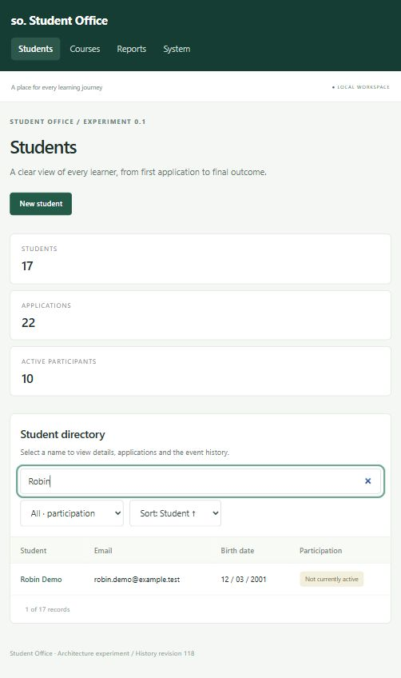

# Verification — 8 October 2026

## Automated

- .NET backend build: successful, warnings treated as errors.
- Fable compilation and esbuild browser bundle: successful; no major frontend framework.
- F# suite: **36 passed, 0 failed**. Domain decisions, evolution, all terminal outcomes, date boundaries, report definitions, UI composition, all v1 event codecs plus committed historical payload fixtures, stale writers, append-only guards, transaction rollback, replay and SQLite backups.
- HTTP suite: **9 scenarios passed, 0 failed** (Node reports 10 including the parent suite). Against a separately launched server and database, covers every page, assets, atomic creation, atomic bulk approval, concurrent stale requests, malformed input, origin checks, rebuild, backup download, restart replay, and opening the downloaded backup as the new authoritative database.

Run commands and requirements are in the README. Test databases and server logs remain under ignored `test-results/`. The HTTP suite uses port 5081; the interactive demo uses 5080.

## Actual browser verification

Used the Codex in-app browser against the compiled Fable app, not screenshots of mockups. Verified:

1. Seeded student list, shared columns and student navigation.
2. Student participation filter combined with live text search; clearing filters; descending name sorting.
3. New student form: entered fictional Robin Demo, email, birth date, and Digital skills. Submission created a stable student identity and an application in one operation.
4. Student approval dialog: accepted the effective start date, then observed participation actions replace application-decision actions.
5. Attendance dialog: recorded Present and observed it in the attendance table and history.
6. Completion dialog: selected Passed, observed terminal status, and verified mutation actions disappeared from that course-history row.
7. Course filter: selected Submitted, selected all visible pending applications, observed exactly three selected, approved them, and observed “Saved 3 event(s).” and the updated participant states.
8. Reports: verified prior participation groups, presence percentages, and “No data” for newly approved participants with no attendance marks.
9. System: rebuilt current state successfully with event count preserved; searched event log and inspected the empty-results state.
10. Reloaded the browser after the final backend/frontend build and checked the rendered page and browser console.

The interactive database intentionally retains these fictional workflow events. Fresh `--demo` databases always start with the documented baseline. No real personal data was used.

## Issues found and fixed

- Initial SQLite native package failed vulnerability auditing: updated Microsoft.Data.Sqlite to 10.0.12.
- F# test fixture initialization needed a separate test entry-point file; fixtures now execute before tests.
- Online SQLite backup on Windows initially left the temporary file pooled/open: disabled pooling for the destination connection, then verified download and restart from the downloaded copy.
- Added input null checks and unknown-report-course rejection after exercising the HTTP boundary.
- Added a student participation filter and improved narrow-window table readability during visual inspection.

## Remaining limits

This is a basic usability check, not a full accessibility audit or a cross-browser/device matrix. Native dialogs and date inputs depend on browser support. Wide tables scroll horizontally; filters reset after commands because pages are regenerated. The owner-readability hypothesis still needs evaluation by the application owner. No production security or load testing is claimed.
